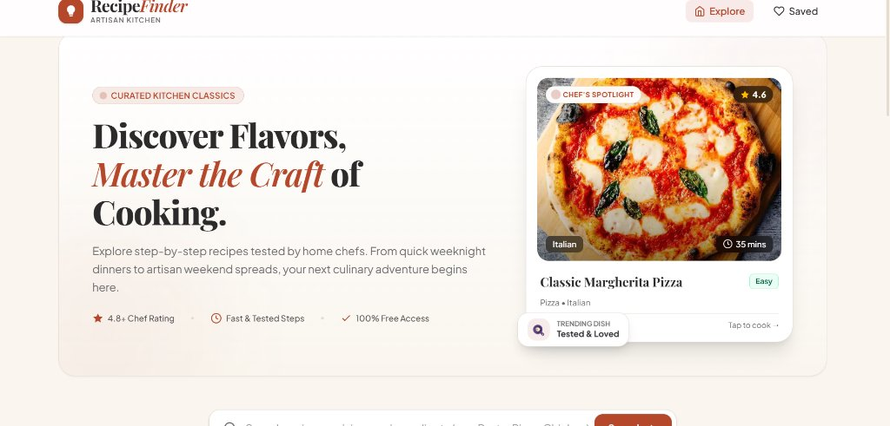
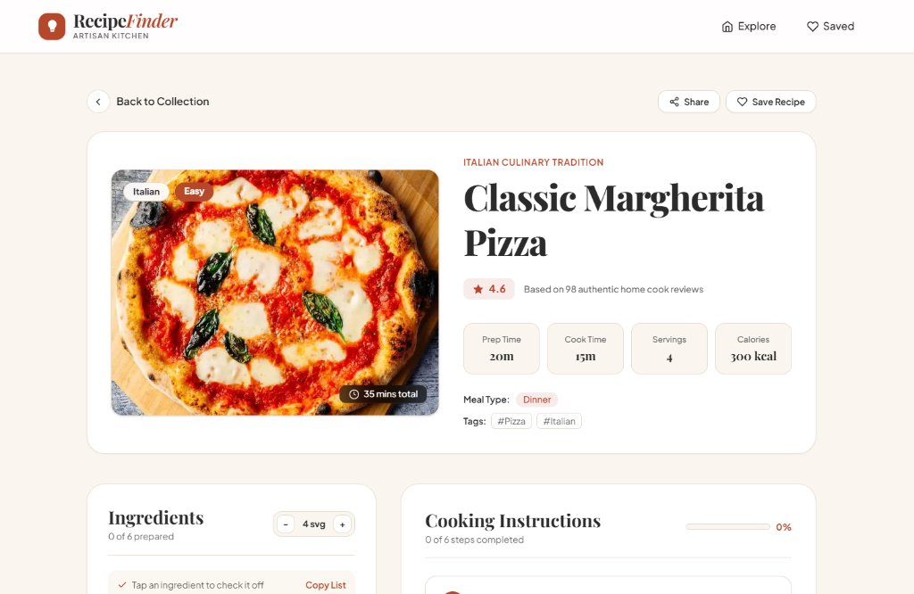
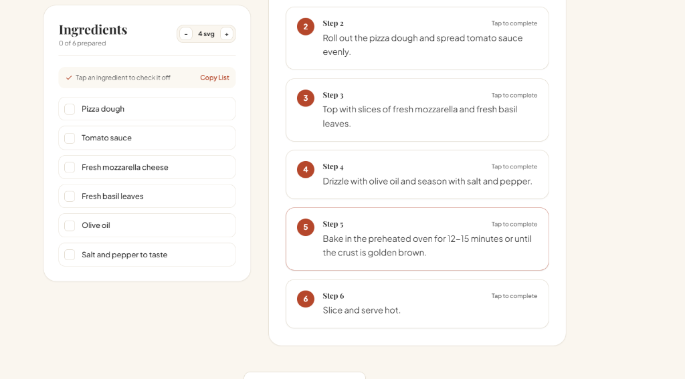

<div align="center">

# 🍳 RecipeFinder
### *Handcrafted Culinary Discoveries & Interactive Kitchen Assistant*

An editorial, magazine-inspired recipe application built with **React 19**, **Vite**, and **Tailwind CSS v4**. Discover handpicked dishes from around the world with interactive cooking checklists, dynamic portion scalers, real-time search, and a personal cookbook bookmarking system.

[](https://react-route-blue.vercel.app/)
[](https://react.dev/)
[](https://tailwindcss.com/)
[](https://vitejs.dev/)

[**Explore Live Application →**](https://react-route-blue.vercel.app/)

---

</div>

## 📸 Visual Showcase

### 1. Editorial Home & Chef's Spotlight Hero
Featuring a warm artisanal culinary palette, interactive search with trending tags, and a dynamic **Chef's Spotlight** card.

<div align="center">
  
</div>

<br />

### 2. Recipe Overview & Key Culinary Metrics
Detailed nutrition statistics (Prep time, Cook time, Servings, Calories) paired with ratings and tags.

<div align="center">
  
</div>

<br />

### 3. Interactive Cooking Mode & Checklist
Step-by-step cooking progress tracking, dynamic serving adjuster, and tap-to-complete ingredient checklists.

<div align="center">
  
</div>

---

## ✨ Key Features

- **🎨 Michelin Editorial Aesthetic**:
  - Handcrafted color harmony: Linen Cream (`#faf6ef`), Terracotta Accent (`#b5472b`), Deep Charcoal (`#2b2b2b`), and Warm Parchment (`#e3dccf`).
  - Sophisticated typography pairing: *Playfair Display* for titles and *Plus Jakarta Sans* for clean, modern readability.

- **👨‍🍳 Interactive Kitchen Assistant**:
  - **Click-to-Check Ingredients**: Mark off ingredients as you prepare them with instant strike-through animations and completion counters.
  - **Dynamic Servings Scaler**: Interactive `[-]` / `[+]` portion multiplier to adapt quantities for family meals or dinner parties.
  - **One-Click Grocery Copy**: Quickly copy the entire ingredients list formatted for messaging or notes.
  - **Step-by-Step Cooking Timeline**: Numbered instruction cards with interactive completion tracking and progress bar.

- **🔍 Smart Search & Categorization**:
  - Real-time search with clear button and focus glow.
  - Quick-filter chips for trending categories (*Italian*, *Pizza*, *Pasta*, *Chicken*, *Salad*, *Dessert*, *Asian*).
  - Search query URL synchronization (`?q=...`) for effortless sharing and bookmarking.

- **❤️ Client-Side Saved Recipes Drawer**:
  - Save favorite dishes with a single click.
  - Persistent storage using `localStorage` with reactive badge updates.
  - Slide-over cookbook drawer with instant quick-jump navigation.

- **⚡ Performance & Smooth Transitions**:
  - Warm shimmer skeleton loaders for instant perceived performance.
  - Responsive layout optimized across mobile, tablet, and widescreen displays.
  - Accessible contrast ratios and custom styled scrollbars.

---

## 🛠️ Tech Stack

| Layer | Technology |
| :--- | :--- |
| **Framework** | [React 19](https://react.dev/) |
| **Styling** | [Tailwind CSS v4](https://tailwindcss.com/) (`@tailwindcss/vite`) |
| **Routing** | [React Router](https://reactrouter.com/) |
| **Build Tool** | [Vite](https://vitejs.dev/) |
| **HTTP Client** | [Axios](https://axios-http.com/) |
| **API Provider** | [DummyJSON Recipes API](https://dummyjson.com/docs/recipes) |
| **Deployment** | [Vercel](https://vercel.com/) |

---

## 📂 Project Architecture

```
ReactProject2/
├── docs/
│   └── screenshots/              # High-resolution README previews
│       ├── hero-home.jpg
│       ├── recipe-overview.jpg
│       └── interactive-cooking.png
├── public/
│   ├── favicon.svg               # Culinary brand favicon
│   └── icons.svg
├── src/
│   ├── assets/                   # Static imagery & assets
│   ├── Components/
│   │   ├── Navbar.jsx            # Glassmorphic header with Saved Drawer
│   │   ├── Recipecard.jsx        # Elevated recipe card with badges & rating
│   │   ├── Footer.jsx            # Artisan footer with category shortcuts
│   │   └── ScrollToTop.jsx       # Route transition scroll restoration
│   ├── pages/
│   │   ├── Home.jsx              # Hero, search, filter tags & recipe grid
│   │   ├── RecipeDetail.jsx      # Full culinary guide & interactive cooking mode
│   │   └── NotFound.jsx          # Custom 404 platter illustration & guide
│   ├── utils/
│   │   └── favorites.js          # Reactive localStorage favorites manager
│   ├── App.jsx                   # Route configurations & layout shell
│   ├── index.css                 # Tailwind v4 theme, keyframes & animations
│   └── main.jsx                  # Application entry point
├── package.json
└── vite.config.js
```

---

## 🚀 Getting Started

### Prerequisites
- **Node.js** (v18.0.0 or higher recommended)
- **npm** or **pnpm**

### Installation

1. **Clone the repository**:
   ```bash
   git clone https://github.com/your-username/recipe-project.git
   cd recipe-project
   ```

2. **Install dependencies**:
   ```bash
   npm install
   ```

3. **Start the local development server**:
   ```bash
   npm run dev
   ```
   Open [http://localhost:5173](http://localhost:5173) in your browser.

4. **Build for production**:
   ```bash
   npm run build
   ```

5. **Lint and format checks**:
   ```bash
   npm run lint
   ```

---

## 🌐 Deployment

The project is pre-configured for one-click deployment on **Vercel** with the included `vercel.json` rewrite rules for single-page client routing:

```json
{
  "rewrites": [{ "source": "/(.*)", "destination": "/" }]
}
```

---

## 📄 License

This project is licensed under the [MIT License](LICENSE) — feel free to explore, fork, and build upon it.

<div align="center">
  <sub>Crafted with passion for good food &amp; modern frontend engineering.</sub>
</div>
